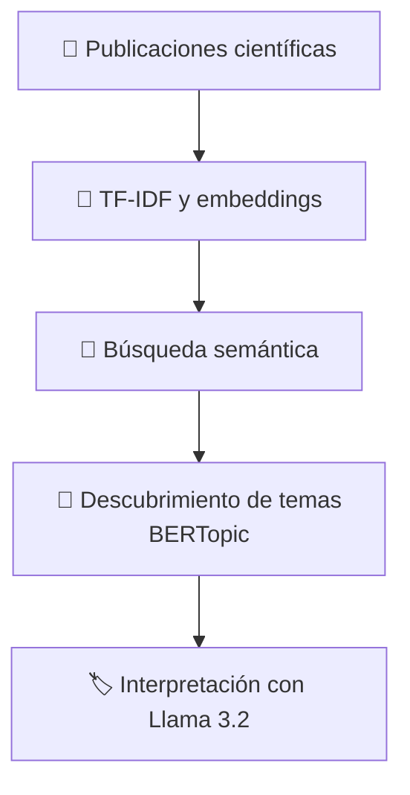

# Taller de Procesamiento del Lenguaje Natural (NLP)

Material del taller **«¿Entienden las máquinas lo que escribimos? Un taller práctico de Procesamiento de Lenguaje Natural»**, organizado en el marco de las actividades de Santa Tecla de la Facultad de Ciencias Sociales y Tecnologías de la Información (UCLM).

El taller introduce de forma práctica conceptos como **TF-IDF, embeddings, búsqueda semántica, modelado de temas con BERTopic y modelos de lenguaje (Llama 3.2)**, utilizando un conjunto de publicaciones científicas.

## ¿Qué haremos en el taller?

## Contenido

- `TallerNLP.ipynb`: cuaderno interactivo de Google Colab con las actividades del taller.
- `computer_science_scopus.csv`: conjunto de datos de publicaciones científicas utilizado en los ejercicios.

## Ejecutar el taller

Para participar únicamente necesitas una **cuenta de Google y conexión a Internet**. No es necesario instalar Python ni ninguna biblioteca en tu ordenador.

Se recomienda guardar una copia del cuaderno en Google Drive y activar la GPU en Google Colab, si está disponible.

**Importante:** para utilizar Llama 3.2 necesitarás una cuenta de [Hugging Face](https://huggingface.co), acceso autorizado al [modelo Llama 3.2 1B Instruct](https://huggingface.co/meta-llama/Llama-3.2-1B-Instruct) y un [token de acceso](https://huggingface.co/settings/tokens).

## Ponentes

- David Carneros Prado
- Ana Díaz Muñoz
- Jared Guerrero Sosa
